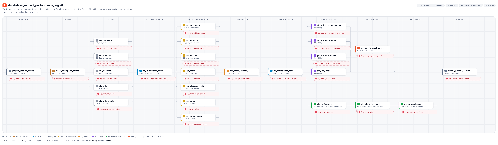

<div align="center">

# 🏗️ DataCo Supply Chain · Data Lakehouse

### Plataforma de datos **ELT end-to-end** sobre Databricks Lakehouse — de SSIS on-premise a un Lakehouse cloud gobernado, con calidad declarativa probada, observabilidad, infraestructura como código y Machine Learning

De SharePoint al correo del área de negocio: ingesta, modelo dimensional con historial, calidad de datos verificada con datos defectuosos, gobierno, un reporte ejecutivo que se envía solo y, en la hoja de ruta, despliegue en la nube y un modelo que anticipa retrasos en los envíos.

<br>


</div>

> 🚧 **En construcción** marca lo que está diseñado pero todavía no está implementado en este repositorio. Lo demás ya corre de punta a punta. El detalle de lo que sigue está en la [hoja de ruta](#️-hoja-de-ruta).

---

## 🎯 En una línea

Tomé un reporte logístico que se armaba a mano cada semana cruzando exports en Excel (2–3 horas de un analista) y lo convertí en una **plataforma de datos gobernada de punta a punta** sobre Databricks Lakehouse: ingesta desde SharePoint, procesamiento en capas con **24 reglas de calidad probadas con datos defectuosos**, siete indicadores de negocio, un Excel ejecutivo enviado por correo, trazabilidad y alertas.

## ⭐ Lo que resuelve

- **Antes:** proceso manual, lento y con cifras distintas entre áreas según el corte.
- **Ahora:** una sola corrida reproducible, con reglas de negocio centralizadas, calidad validada antes de publicar, historial de cambios y entrega automática al área.

---

## 🧭 Estado del proyecto

| Fase | Alcance | Estado |
|---|---|---|
| **1. Pipeline de datos** | Bronze → Silver → Gold: ingesta cruda en STRING con metadatos, hash del archivo e idempotencia por corte; tipado, deduplicación determinista y cuarentena en las 5 tablas Silver; modelo estrella con SCD2, 7 indicadores y Excel ejecutivo enviado por correo | ✅ Completa |
| **2. Calidad de datos** | 24 reglas declarativas, decisión por regla, dos compuertas, pruebas con datos defectuosos de los tres comportamientos | ✅ **Completa** |
| **3. Ingeniería de software, CI y CD** | Módulo compartido, 13 pruebas con `pytest` ejecutadas en GitHub Actions, el Job completo descrito como código con Databricks Asset Bundles y despliegue automático a `dev` al fusionar a `main` | ✅ **Completa** |
| **4. Gobierno** | Comentarios por tabla y por columna, tags, llaves informativas, máscara de PII y GRANT por rol, diccionario de datos consultable, tags y permisos por capa | ✅ **Completa** |
| **5. Reprocesabilidad** | SCD2 con fecha de negocio, snapshots regenerables, backfill y reinicio | 🚧 En construcción |
| **6. Nube y escala** | Despliegue automático a `prod`, entorno de producción en Azure Databricks con ADLS Gen2, Auto Loader, prueba de escala medida | 🚧 En construcción |
| **7. Nivel plataforma** | Contratos de datos, evolución de esquema, SLOs, runbooks, incidentes simulados con postmortem | 🚧 En construcción |
| **8. Machine Learning** | Modelo de riesgo de retraso con MLflow en Unity Catalog | 🚧 En construcción |

---

## 🧭 Pipeline de un vistazo

```
SharePoint ──▶ 🥉 Bronze ──▶ 🥈 Silver ──▶ ✅ Calidad ──▶ 🥇 Gold ──▶ ✅ Calidad ──▶ 📊 Excel + 📧 Correo
             (crudo, todo    (tipado,      (21 reglas   (modelo      (3 reglas      (reporte ejecutivo
              STRING +        dedupe,       + cuarentena) estrella +    de consistencia) automático)
              metadatos)      cuarentena)                 KPIs)
                                                                   └──▶ 🤖 ML: riesgo de retraso 🚧
                    └──── 📋 etl_log + 🚨 alertas Slack + 📈 dashboard de salud en cada task ────┘
```

| | |
|---|---|
| **Fuente** | Archivo en SharePoint Online, descargado vía Microsoft Graph |
| **Procesamiento** | PySpark + Spark SQL sobre Delta Lake |
| **Arquitectura** | Data Lakehouse con modelo medallón |
| **Orquestación** | Un único Databricks Workflow (compute Serverless) en abanico, con dos compuertas de calidad, descrito como código y con alerta si la ejecución supera los 35 minutos |
| **Modelo** | Esquema estrella con **SCD2** en dimensiones y hechos clave |
| **Calidad** | **24 reglas** (21 en Silver y 3 en Gold) en seis dimensiones; el dato defectuoso va a cuarentena con alerta y solo los errores propios del pipeline lo detienen |
| **Pruebas de calidad** | Los tres comportamientos (cuarentena, advertir, detener) verificados con el Workflow real sobre un esquema aislado, con cantidades esperadas calculadas a partir de los datos |
| **Gobierno** | En Gold: comentario con grano y owner, tags de clasificación, llaves primarias y foráneas informativas, máscara del correo del cliente y permisos por rol en Unity Catalog. Además, comentario en cada columna de Silver y Gold, un diccionario de datos consultable y permisos por capa |
| **Observabilidad** | Tabla `etl_log`, alerta a Slack ante cualquier fallo, vistas de salud y dashboard AI/BI |
| **Infraestructura, CI y CD** | Job descrito como código con **Databricks Asset Bundles** (con alerta si la ejecución supera los 35 minutos), **13 pruebas con `pytest`** que corren en **GitHub Actions** en cada cambio, y **despliegue automático** a `dev`: el pull request valida el bundle y el merge a `main` lo despliega. 🚧 *En construcción:* entorno `prod` y, opcionalmente, Terraform |
| **Entrega** | Excel de 4 pestañas enviado por correo (Microsoft Graph) |
| **ML** | 🚧 *En construcción:* modelo de riesgo de retraso con MLflow, registrado en Unity Catalog |

---

## 🔧 Qué hace cada capa

### 🥉 Bronze — ingesta cruda
Descarga el archivo desde SharePoint y carga **solo el corte de fechas** definido en una tabla de control. Todas las columnas de negocio se almacenan como **STRING**, sin inferir tipos ni aplicar reglas de negocio, para no perder información del origen; solo las columnas técnicas están tipadas. Cada fila lleva sus metadatos: fecha de carga, ejecución, origen, archivo, **hash SHA-256 del archivo**, filas del archivo y esquema original en JSON. Bronze conserva todos los registros, incluidos los duplicados: la deduplicación ocurre en Silver. El proceso es idempotente: si los cortes se traslapan, los días de la ventana se reemplazan y no se duplican. La tabla define una **retención de 365 días** del historial Delta y lleva COMMENT y tags de gobierno (capa, dominio, owner y frecuencia). Sin permisos para grupos de lectura: solo ingeniería accede.

### 🥈 Silver — datos limpios y conformados
Tipado fuerte con conversión segura (un texto no convertible queda en `NULL` y la fila se aísla; nunca se reemplaza por cero), normalización y deduplicación **determinista** por llave de negocio, priorizando el corte más reciente. Separa el origen en entidades: clientes, productos, ubicaciones, pedidos y detalle de pedido. Las filas que no cumplen una regla **no se eliminan**: pasan a **cuarentena** con su motivo, en las cinco tablas, y Gold lee solo las filas válidas. Cada ejecución deja registro de la deduplicación y de la cuarentena. Cada fila conserva su trazabilidad hacia Bronze.

### ✅ Calidad de datos — compuerta entre capas
Dos tasks de validación (tras Silver y tras Gold) ejecutan el catálogo de reglas y guardan cada resultado en una tabla histórica. La decisión ante un incumplimiento está definida por regla: **detener** el pipeline, enviar a **cuarentena** o solo **advertir**. Si una regla detiene el pipeline, la task falla, se registra el error y el Workflow se detiene.

### 🥇 Gold — modelo dimensional y KPIs
Esquema estrella listo para análisis, con **grano declarado** en cada tabla:
- **5 dimensiones** (clientes y productos con historial SCD2; ubicaciones, fecha y modo de envío) con llaves sustitutas: hash estable en ubicaciones y modos de envío, y secuenciales en las tablas con historial SCD2 ([ADR-008](docs/adr/008-llaves-sustitutas.md)).
- **2 tablas de hechos** (pedidos con SCD2 y reglas de negocio; detalle de pedido).
- **Resumen por pedido** como base única de los indicadores.
- **4 vistas de KPIs:** Resumen Ejecutivo, Detalle por Región, Detalle por Orden (SCD2) y Alertas, con historial por corte.
- Cada tabla lleva en su COMMENT el grano y el owner. 🚧 *En construcción:* la versión del KPI y el comentario por columna.

### 📊 Entrega a negocio
Un notebook genera el **Excel de 4 pestañas** con formato condicional tipo semáforo y variación contra el corte anterior, y lo **envía por correo** con una tabla resumen y un gráfico en el cuerpo del mensaje.

### 🤖 Machine Learning &nbsp; 🚧 *En construcción*
> 🚧 Esta capa está en desarrollo; el pipeline de datos de arriba ya corre de punta a punta sin ella.

La capa Gold alimentará un modelo que predice el **riesgo de retraso** de cada envío. Se entrenará y evaluará **solo con datos reales**, con separación temporal (entrenar con el pasado y probar con el futuro) para evitar fuga de datos. El entrenamiento se registrará en **MLflow**, el modelo quedará versionado en **Unity Catalog** y sus predicciones se guardarán en una tabla Gold. Los datos sintéticos de volumen se usan solo para medir escala y nunca para entrenar.

---

## 📐 Los 7 indicadores

On-Time Delivery % · Late Delivery Risk % · Shipping Variance · Profit Margin % · Revenue por Cliente · Beneficio por Orden · Lead Time Promedio

Con agrupaciones de negocio **GLOBAL** (todos los mercados) y **AMERICAS** (LATAM + USCA), y reglas de alcance: se excluyen los pedidos cancelados y se marcan los sospechosos de fraude.

---

## 🗂️ Modelo dimensional

```
        dim_customers        dim_products
              │                    │
              ▼                    ▼
  dim_fecha ─▶ fact_orders ◀─ fact_order_details ◀─ dim_products
              ▲       ▲
        dim_locations  dim_shipping_mode
```

Las dimensiones de clientes y productos y la tabla de hechos de pedidos usan **SCD2** sobre una lista explícita de columnas de seguimiento: conservan el historial, de modo que cada pedido puede analizarse con los atributos vigentes en su momento. Las tablas de Gold declaran llaves primarias y foráneas informativas y la llave `NOT NULL`; no llevan `CHECK`, porque Databricks no lo permite junto a una máscara de columna ([ADR-014](docs/adr/014-gobierno-en-gold.md)). Cada columna lleva su descripción en el catálogo.

---

## 🛡️ Calidad de datos

### Cuarentena y deduplicación con trazabilidad

Ningún registro se elimina. Cada tabla Silver agrega tres columnas (`estado_calidad`: `VALIDO` o `CUARENTENA`, `motivo_cuarentena` y `fecha_procesamiento`) y **Gold lee únicamente las filas `VALIDO`**.

| Tabla Silver | Grano (una fila por…) | Motivos de cuarentena |
|---|---|---|
| `hd_pedidos` | pedido (`order_id`) | `ORDER_ID_INVALIDO` · `FECHA_PEDIDO_INVALIDA` · `CLIENTE_NO_INFORMADO` · `RIESGO_RETRASO_INVALIDO` · `TIPO_DATO_INVALIDO` · `PEDIDO_SIN_CLIENTE` · `PEDIDO_SIN_UBICACION` |
| `hd_pedido_detalle` | ítem del pedido (`order_item_id`) | `ITEM_ID_INVALIDO` · `CANTIDAD_INVALIDA` · `TIPO_DATO_INVALIDO` · `LINEA_SIN_PEDIDO` · `LINEA_SIN_PRODUCTO` |
| `md_clientes` | cliente (`customer_id`) | `CLIENTE_ID_INVALIDO` |
| `md_productos` | producto (`product_card_id`) | `PRODUCTO_ID_INVALIDO` · `TIPO_DATO_INVALIDO` |
| `md_ubicaciones` | combinación geográfica (market, región, país, estado, ciudad y código postal) | `UBICACION_INCOMPLETA` · `TIPO_DATO_INVALIDO` |

Cada fila recibe un solo motivo: el primero que se cumple, en un orden definido por tabla. Dos tablas de control en `metadata_dataco` registran cada ejecución:

- **`hd_deduplicacion_log`:** filas de entrada y de salida por tabla, filas agrupadas (informativo) y **duplicados reales**, que debe ser 0.
- **`hd_cuarentena_resumen`:** filas en cuarentena por tabla y motivo.

**Resultado de la última corrida de producción:** 65,752 pedidos, 180,519 líneas de detalle, 20,652 clientes, 118 productos y 3,800 ubicaciones en Silver; **0 duplicados reales y 0 filas en cuarentena**. Gold: 64,385 pedidos vigentes (los cancelados se excluyen por regla de negocio). Las **24 reglas** dieron `CUMPLE`.

### Motor declarativo de reglas

El motor se basa en dos tablas: un **catálogo de reglas** (`md_dq_reglas`) y un **historial de resultados** por ejecución (`hd_dq_resultados`).

| Dimensión | Qué verifica | Ejemplos |
|---|---|---|
| **Unicidad** | Una fila por llave de negocio | `order_id`, `order_item_id`, `customer_id`, `product_card_id` |
| **Completitud** | Campos obligatorios informados | Fechas de pedido y de envío |
| **Validez** | Valores dentro del dominio | Riesgo de retraso en {0,1}; cantidad > 0; texto no convertible a número |
| **Integridad referencial** | Las referencias existen | Detalle → pedido y producto, pedido → cliente y ubicación |
| **Consistencia** | Silver y Gold cuadran | Pedidos vigentes = pedidos no cancelados; un resumen por pedido |
| **Actualidad** | El dato llegó a tiempo | El corte cargado coincide con la tabla de control; el volumen diario no cae a menos de la mitad del promedio previo |

Cada regla se define en lenguaje de negocio, con **criticidad**, **umbral** justificado, **decisión** ante incumplimiento, owner y steward (como roles). El criterio es: el dato defectuoso va a **cuarentena** con alerta a Slack sin detener el pipeline; un exceso sobre el umbral solo **advierte**; el pipeline **se detiene** únicamente ante errores propios (duplicados tras deduplicar, llaves rotas en Gold o Silver que no cuadra con Gold).

| Decisión | Reglas |
|---|---|
| **Detener** (7) | DQ-001 a DQ-004 (unicidad en Silver) · DQ-014, DQ-015, DQ-016 (Gold) |
| **Cuarentena** (9) | DQ-005, DQ-006, DQ-008, DQ-009, DQ-011, DQ-012, DQ-013, DQ-023, DQ-024 |
| **Advertir** (8) | DQ-007, DQ-010, DQ-017 a DQ-022 |

Las reglas de integridad referencial **aíslan** las filas defectuosas con una consulta propia (por ejemplo, DQ-024 aparta los pedidos cuya ubicación no existe como válida en `md_ubicaciones`); las demás miden lo que Silver ya aisló al cargar.

### 🧪 Pruebas con datos defectuosos

Los tres comportamientos se prueban corriendo **el Workflow real** (no notebooks sueltos) sobre un esquema aislado, `pruebas_calidad`, con datos sintéticos defectuosos generados por código a partir de filas reales. El **mismo Job** se usa para producción y para pruebas: los parámetros de catálogo y esquema redirigen los mismos notebooks a las tablas de prueba, sin tocar los datos ni los logs de producción. Durante estas pruebas, una condición `es_modo_prueba` omitía el correo y la actualización de la tabla de control; esa condición no está en el Job versionado actual y su reactivación está en la etapa C.

Las cantidades esperadas **no están escritas a mano**: se calculan a partir de los datos inyectados y se guardan junto a ellos (`casos_esperados` y `casos_esperados_dq`).

| Etapa | Qué se prueba | Resultado observado |
|---|---|---|
| **1. Cuarentena** | Un caso por motivo sobre 10,500 filas de Bronze (sanas y defectuosas) | Las filas se apartan con su motivo y el pipeline sigue: DQ-024 aisló 1,000 pedidos, DQ-011 733 líneas, DQ-013 452 pedidos; Gold queda consistente (DQ-014 y DQ-015 en `CUMPLE`); la comparación contra lo esperado coincide en todos los casos |
| **2. Advertir** | Fechas de envío vacías y estados de pedido desconocidos | DQ-007 y DQ-010 quedan en `ADVERTENCIA` con **100 filas detectadas, 100 esperadas**; el pipeline sigue y llega la alerta |
| **3. Detener** | Un cliente duplicado sembrado | DQ-003 detecta **1 duplicado (1 esperado)** y queda `DETENIDO`; Silver termina, Gold no corre y llega la alerta de fallo |

Antes de cada escenario se reinician las tablas Silver y Gold de prueba, porque la dimensión de pedidos Gold es SCD2 y conserva historial entre corridas. El procedimiento paso a paso está en [`docs/tests_manuales.md`](docs/tests_manuales.md).

> 🚧 *En construcción:* que las corridas de prueba también registren el mensaje de error de la excepción en su propio log (hoy el detalle queda en la salida de la task).

---

## 🔐 Gobierno de datos (Unity Catalog) &nbsp; ✅ *Completa*

Se aplica con un notebook idempotente (`00_metadata/04_gobierno/aplicar_gobierno`), que se ejecuta cuando cambia el modelo:

- **Comentario y tags:** cada tabla de Bronze, Silver y Gold lleva su descripción y los tags `clasificacion` y `layer`.
- **Comentario por columna:** 262 columnas de Silver y Gold con su significado de negocio, a partir de un diccionario único por nombre de columna.
- **Diccionario de datos consultable:** `metadata_dataco.supply_chain.md_diccionario_datos`, generado desde `information_schema` (536 columnas de las tres capas, con tipo, descripción y marca de dato personal). Se regenera al ejecutar el notebook.
- **Llaves informativas en Gold:** llaves primarias (verificadas como únicas y sin nulos antes de declararlas) y llaves foráneas entre hechos y dimensiones.
- **Enmascaramiento dinámico** del correo del cliente en Gold (`desc_dim_customers`) y en Silver (`md_clientes`): la columna lleva el tag `DAC = YES` y los miembros de `dac_lectores` y `dac_analistas_avanzados` ven `***@***`.
- **GRANT por rol:** `dac_lectores` consulta Gold; `dac_analistas_avanzados` consulta Silver; Bronze no tiene permisos para grupos de lectura, solo ingeniería.

**Probado, no aplicado:** el **filtro de filas** funciona con el mismo grupo, pero falta definir el criterio de negocio que decide qué filas ve cada grupo.

**Límites de Free Edition y de Databricks** (detalle en el [ADR-014](docs/adr/014-gobierno-en-gold.md)): una máscara no convive con restricciones `CHECK`, y las restricciones solo van en Gold porque las filas en cuarentena de Silver pueden traer llaves nulas o repetidas.

---

## 📈 Observabilidad

- **Tabla `etl_log`:** cada notebook registra inicio, fin, filas procesadas y estado (`EN_PROCESO → EXITOSO / ERROR`), con un identificador único por ejecución.
- **Manejo de errores:** cada task tiene su task de log que, ante un fallo, registra el detalle técnico y **avisa a Slack**. El Workflow se detiene cuando una task falla.
- **Control de corte:** una tabla de parámetros define la ventana a procesar; reprocesar el mismo corte es idempotente.
- **Dashboard AI/BI "Salud del pipeline":** estado de la última ejecución, duración por notebook, tendencia diaria y errores recientes.

<p align="center">
  
</p>

---

## 🧪 Ingeniería de software, CI y CD

- **Funciones compartidas:** `clean_str`, `clean_num`, `tipo_invalido` y `dedup_reciente` viven en un solo módulo, `modulos_compartidos/transformaciones_silver.py`, que importan los cinco notebooks Silver. Antes se copiaban en cada notebook.
- **13 pruebas con datos de ejemplo:** filas creadas en memoria, sin tocar las tablas reales. Comprueban, por ejemplo, que un valor vacío o no convertible da `NULL` y nunca `0`, y que de una llave repetida se conserva la fila del corte más reciente. Un error en el módulo afectaría a las cinco tablas Silver; por eso están probadas.
- **CI con GitHub Actions:** en cada push a `main` y en cada pull request se levanta una máquina limpia con Java, Spark y `pytest`, y se ejecutan las pruebas.
- **Job como código:** el Job se exportó del Workflow que ya funcionaba y se describe en YAML (46 tasks, dependencias, parámetros, notificaciones y alerta de duración). Se desplegó con Asset Bundles y se ejecutó de punta a punta desde el repositorio.
- **CD con GitHub Actions:** en un pull request se valida el bundle (`databricks bundle validate`) sin tocar Databricks; al fusionar a `main` se despliega el Job `[dev jsosa]` (`databricks bundle deploy`). El despliegue **no ejecuta** el Job: correrlo, con su correo real y sus escrituras de datos, es una decisión aparte ([ADR-004](docs/adr/004-cd-solo-despliega.md)). La URL del workspace, el token y el correo de alertas viven solo en GitHub Secrets; ningún archivo del repositorio los contiene. El token es personal, de 90 días, porque Free Edition no permite service principals.

---

## 🔄 Tubería de datos de punta a punta

Pipeline orquestado como un único Databricks Workflow, descrito como código con Asset Bundles y con las tasks en **abanico**: tras la ingesta, las cinco tablas Silver corren en paralelo, y lo mismo las cinco dimensiones Gold y los cuatro KPIs. Entre capas, las tasks de calidad **`dq_validaciones_silver`** y **`dq_validaciones_gold`** validan los datos y detienen el flujo si una regla crítica falla. Cada task tiene su `log_error` que, ante un fallo, registra la excepción en `hd_etl_log` y notifica a Slack. Una alerta avisa por correo si una ejecución supera los 35 minutos.

**Cadena frente a abanico, medido** sobre el mismo código en Databricks Free Edition: la cadena lineal tardó **16 min 34 s** y el abanico **19 min**. El abanico no gana tiempo porque el cómputo serverless es compartido y limita las tareas concurrentes; se versiona en abanico porque deja el grafo listo para un entorno con más capacidad (etapa D). El detalle está en el [ADR-001](docs/adr/001-abanico-vs-cadena.md).

<p align="center">
  
</p>

*Diseño objetivo en abanico. Las tasks en verde (Machine Learning) están en construcción 🚧 y no forman parte del Job versionado en `resources/`. Los conteos de reglas del diagrama (19 en Silver y 22 en total) corresponden a una versión anterior del catálogo; el vigente tiene 21 y 24.*

**Recorrido de una ejecución**

```
prepare_pipeline_control
          │
          ▼
ingest_sharepoint_bronze              (SharePoint → Bronze, por corte)
          │
          ▼
slv_customers · slv_products · slv_locations · slv_orders · slv_order_details     (en paralelo)
          │
          ▼
dq_validaciones_silver                (compuerta de calidad, 21 reglas)
          │
          ▼
gld_customers · gld_fecha · gld_locations · gld_products · gld_shipping_mode      (en paralelo)
          │
          ▼
gld_orders ──▶ gld_order_details ──▶ gld_order_summary    (hechos y base única de los KPIs)
          │
          ▼
dq_validaciones_gold                  (compuerta de calidad, 3 reglas)
          │
          ▼
gld_kpi_executive_summary · gld_kpi_order_details · gld_kpi_alerts · gld_kpi_region_detail   (en paralelo)
          │
          ▼
gld_reporte_excel_correo              (Excel de 4 pestañas + correo vía Graph)
          │
          ▼
finalize_pipeline_control             (cierre de la ejecución)
```

---

## 🗺️ Hoja de ruta

Cada etapa se publica por separado y tiene un criterio de terminado. Las etapas marcadas con ✅ ya están hechas; el resto es 🚧 *en construcción*.

### Etapa A — Ingeniería de software, CI y CD ✅ Completa
- **Módulo compartido** (`clean_str`, `clean_num`, `tipo_invalido`, `dedup_reciente`) en `modulos_compartidos/`, importado por los cinco notebooks Silver en lugar de repetirse en cada uno.
- **13 pruebas unitarias con `pytest`** sobre esas funciones, en `tests/`.
- **GitHub Actions:** en cada push a `main` y en cada pull request se instalan Spark y Java y se ejecutan las pruebas.
- **Databricks Asset Bundles:** el Job, sus tasks, dependencias, parámetros y notificaciones descritos en YAML, con alerta si la ejecución supera los 35 minutos; validado desplegándolo y ejecutándolo de punta a punta desde el repositorio.
- **CD a `dev`:** un pull request valida el bundle y el merge a `main` despliega el Job `[dev jsosa]`; probado con ambos caminos. Las credenciales están en GitHub Secrets.
- **Decisiones documentadas:** catorce ADRs en `docs/adr/`.
- *El target `prod` y el despliegue automático hacia él pasan a la etapa D.*

### Etapa B — Gobierno y metadatos ✅ Completa
- ✅ **Hecho:** comentario por tabla y por columna, tags de clasificación, llaves primarias y foráneas informativas en Gold, máscara del correo en Gold y Silver, GRANT por rol y diccionario de datos consultable (ADR-014).
- Pendiente menor: filtro de filas con un criterio de negocio definido, y bloque de trazabilidad estándar en la cabecera de cada notebook.
- ✅ **Cumplido:** cualquier tabla se explica sola desde el catálogo y `customer_email` se ve enmascarado para los grupos lectores.

### Etapa C — Reprocesabilidad
- SCD2 con fecha de negocio en lugar de la fecha del sistema; snapshots de KPIs regenerables para cortes pasados.
- Cierre en el SCD2 de los pedidos que pasan a cancelados.
- Backfill por rango de ventanas, notebook de reinicio y marca de ejecuciones interrumpidas en el log.
- Registro del mensaje de error también en las corridas de prueba (parametrizar los `log_error_*`).
- Reactivar el modo de prueba en el Job versionado (condición `es_modo_prueba`).
- **Terminado cuando:** se puede recargar cualquier rango de cortes sin tocar tablas a mano y el resultado es el mismo.

### Etapa D — Nube y escala
- **Despliegue automático a `prod`:** el CD a `dev` ya existe (etapa A); aquí se extiende a `prod`, con aprobación antes de desplegar.
- **Dos entornos con el mismo código:** Databricks Free Edition como `dev` y **Azure Databricks** como `prod`, con almacenamiento externo en **ADLS Gen2**, Unity Catalog con ubicación externa y presupuesto con alerta de costo.
- **Ingesta incremental con Auto Loader** sobre archivos que llegan al almacenamiento, en lugar de leer el archivo completo por ventana.
- **Prueba de escala:** datos sintéticos de decenas o cientos de millones de filas, en un esquema aparte y declarados como sintéticos, con tiempos y costos antes y después de `OPTIMIZE` y liquid clustering.
- **Infraestructura con Terraform** (opcional) para el almacenamiento, las credenciales y los catálogos.
- **Terminado cuando:** el mismo bundle despliega a `dev` y a `prod` y existe un ADR con los tiempos y costos medidos.

### Etapa E — Nivel plataforma
- **Contratos de datos:** un archivo YAML por tabla con columnas, tipos, propietario y frescura exigida, validado automáticamente, y pruebas de qué pasa cuando la fuente agrega, quita o cambia el tipo de una columna.
- **SLOs:** metas de frescura, éxito y duración calculadas sobre `hd_etl_log`, con alerta si se incumplen.
- **Runbooks** para los fallos más comunes e **incidentes simulados con postmortem** publicados en el repositorio.
- **Segunda fuente (opcional):** una fuente pequeña adicional (por ejemplo, una API de tipo de cambio) que entra por la misma plataforma para mostrar que agregar un caso toma horas.
- **Terminado cuando:** un cambio de esquema en la fuente se detecta antes de llegar a Silver y hay al menos un postmortem escrito.

### Etapa F — Machine Learning
Modelo de riesgo de retraso con variables sin fuga de datos, MLflow, modelo versionado en Unity Catalog y tabla de predicciones. Se entrena solo con datos reales.

---

## 🛠️ Stack

| Área | Tecnología |
|---|---|
| Plataforma | Databricks · Serverless |
| Procesamiento | PySpark · Spark SQL |
| Almacenamiento | Delta Lake |
| Catálogo y gobierno | Unity Catalog |
| Ingesta y correo | Microsoft Graph API |
| Secretos | Databricks Secret Scopes |
| Alertas | Webhook de Slack |
| Reportería | openpyxl · matplotlib · Dashboards AI/BI |
| Pruebas | pytest |
| IaC, CI y CD | Databricks Asset Bundles · Databricks CLI · GitHub Actions |
| Terraform 🚧 | Opcional |
| Nube 🚧 | Azure Databricks · ADLS Gen2 · Auto Loader |
| Machine Learning 🚧 | MLflow · Unity Catalog Models |

---

## 📁 Organización del repositorio

```
00_metadata/                  # control del pipeline (prepare / finalize), logs, observabilidad (tablas de calidad, vistas de salud) y gobierno (comentarios, tags, llaves, máscara)
01_ingest_sharepoint_bronze/  # ingesta a Bronze + logs
02_silver_dimensiones/        # clientes, productos, ubicaciones + logs
02_silver_hechos/             # pedidos, detalle de pedido + logs
03_gold_dimensiones/          # 5 dimensiones (clientes, fecha, ubicaciones, productos, modo de envío) + logs
03_gold_hechos/               # pedidos, detalle de pedido, resumen por pedido + logs
03_gold_kpis/                 # 4 KPIs (resumen ejecutivo, alertas, detalle de pedido, detalle por región) + logs
04_reporte_excel_correo/      # reporte Excel enviado por correo + logs
05_pruebas_calidad/           # datos sintéticos defectuosos y verificación de cada comportamiento (cuarentena, advertir, detener)
06_calidad_datos/             # motor de validaciones (24 reglas) + logs
requerimientos/               # especificación no técnica del proyecto
docs/                         # diagrama del workflow, dashboard de salud, pruebas manuales y ADRs (docs/adr/)
05_ml/                        # 🚧 variables, entrenamiento, registro y predicciones
databricks.yml y resources/   # Asset Bundle: Job completo y alerta de duración
modulos_compartidos/          # funciones comunes de Silver, importadas por los cinco notebooks
tests/                        # 13 pruebas con pytest
.github/workflows/            # CI: pruebas en cada push y pull request · CD: valida en el PR y despliega a dev al fusionar a main
```

Cada carpeta separa el notebook de negocio (`01_negocio/`) de su notebook de manejo de errores (`02_logs/`). 🚧 *En construcción:* cada notebook declarará en su cabecera la capa, sus entradas y salidas, su owner y las reglas de calidad asociadas.

---

## 📚 Decisiones de arquitectura (ADRs)

Cada decisión relevante se documenta en [`docs/adr/`](docs/adr/) con su contexto, las alternativas, lo que se decidió y sus consecuencias. Las que tienen una limitación conocida la declaran en su propio texto.

| ADR | Decisión |
|---|---|
| [001](docs/adr/001-abanico-vs-cadena.md) | Orquestar el Job en abanico en vez de en cadena, con los tiempos medidos |
| [002](docs/adr/002-cuarentena-en-silver.md) | Cuarentena en la misma tabla de Silver, sin descartar filas |
| [003](docs/adr/003-modulo-compartido-silver.md) | Módulo compartido para los helpers de Silver, con pruebas automáticas |
| [004](docs/adr/004-cd-solo-despliega.md) | El CD despliega la definición del Job pero no lo ejecuta |
| [005](docs/adr/005-bronze-en-string.md) | Bronze con todas las columnas de negocio en STRING, y su retención |
| [006](docs/adr/006-conversion-segura-de-tipos.md) | Conversión segura de tipos: `NULL` y cuarentena en vez de cero |
| [007](docs/adr/007-prefijos-de-tablas.md) | Convención de prefijos en los nombres de tabla y sus excepciones |
| [008](docs/adr/008-llaves-sustitutas.md) | Llaves sustitutas: hash donde la tabla se reconstruye, secuenciales en las tablas SCD2 (con limitación conocida) |
| [009](docs/adr/009-parametros-de-calidad.md) | Umbrales y decisión por regla en el motor de calidad |
| [010](docs/adr/010-modo-de-prueba-por-parametro.md) | Un solo Job con modo de prueba por parámetro (reactivación en etapa C) |
| [011](docs/adr/011-serverless-sin-particionado.md) | Cómputo serverless, sin particionado ni Z-ORDER a esta escala |
| [012](docs/adr/012-lakehouse-para-volumen-moderado.md) | Usar un Lakehouse para un volumen moderado: gobierno, trazabilidad y reproducibilidad |
| [013](docs/adr/013-datos-sinteticos.md) | Datos sintéticos solo para pruebas y escala, nunca para Machine Learning |
| [014](docs/adr/014-gobierno-en-gold.md) | Gobierno de datos con Unity Catalog y sus límites en Free Edition |

---

## 🧩 Contexto del proyecto

Proyecto que **migra un proceso tradicional** (SQL Server Integration Services sobre Data Warehouse on-premise) a una **arquitectura Lakehouse en la nube**, conservando las reglas de negocio del reporte original.
El dataset es público (*DataCo Smart Supply Chain*, Kaggle) y la infraestructura es real.

---

<div align="center">

**Josuhe Sosa Lara** · Data Engineering · Lima, Perú

*Dataset público · infraestructura real · construido de punta a punta sobre Databricks Lakehouse.*

</div>
